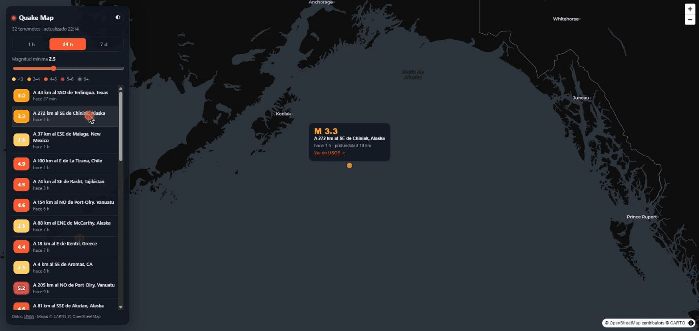

# 🌍 Quake Map

Mapa de terremotos en tiempo real con datos del [USGS](https://earthquake.usgs.gov/). Se actualiza solo cada minuto.


🔗 **Demo:** https://marcosgague.github.io/quake-map/

## Qué hace

- Terremotos de la última hora, 24 h o 7 días, con tamaño y color según la magnitud.
- Pulso animado en los de los últimos 30 minutos.
- Filtro de magnitud mínima y lista lateral: al pulsar uno, el mapa vuela hasta él.
- Modo oscuro y claro, y diseño adaptado a móvil.

## Stack

TypeScript · Vite · MapLibre GL · API GeoJSON pública del USGS (sin clave).

## Desarrollo

```bash
npm install
npm run dev      # servidor local
npm run build    # compilación de producción en dist/
```

## Despliegue

Es una web estática: sirve cualquier hosting (Vercel, Netlify, GitHub Pages). Directorio de salida: `dist`.
